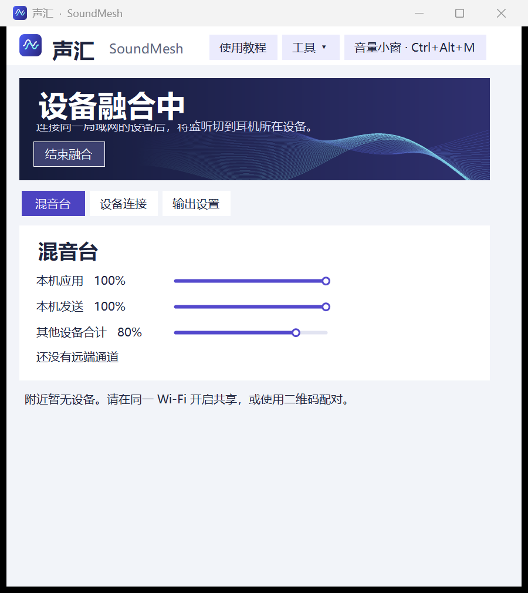
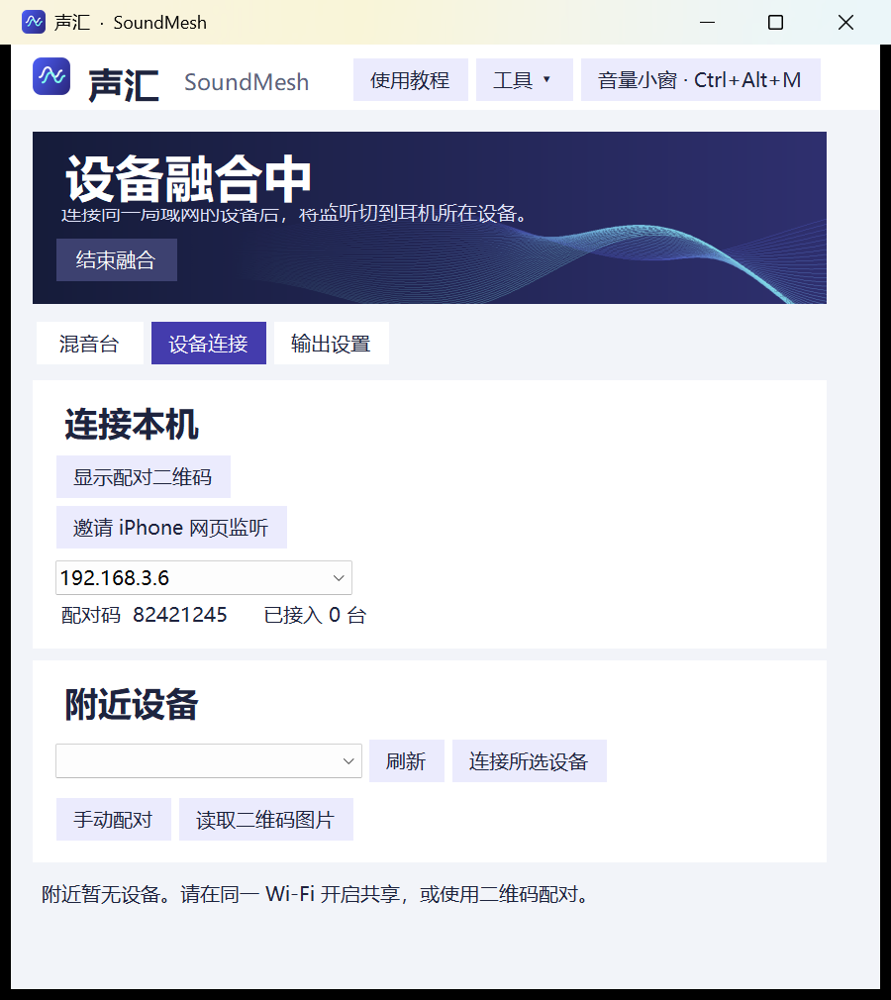
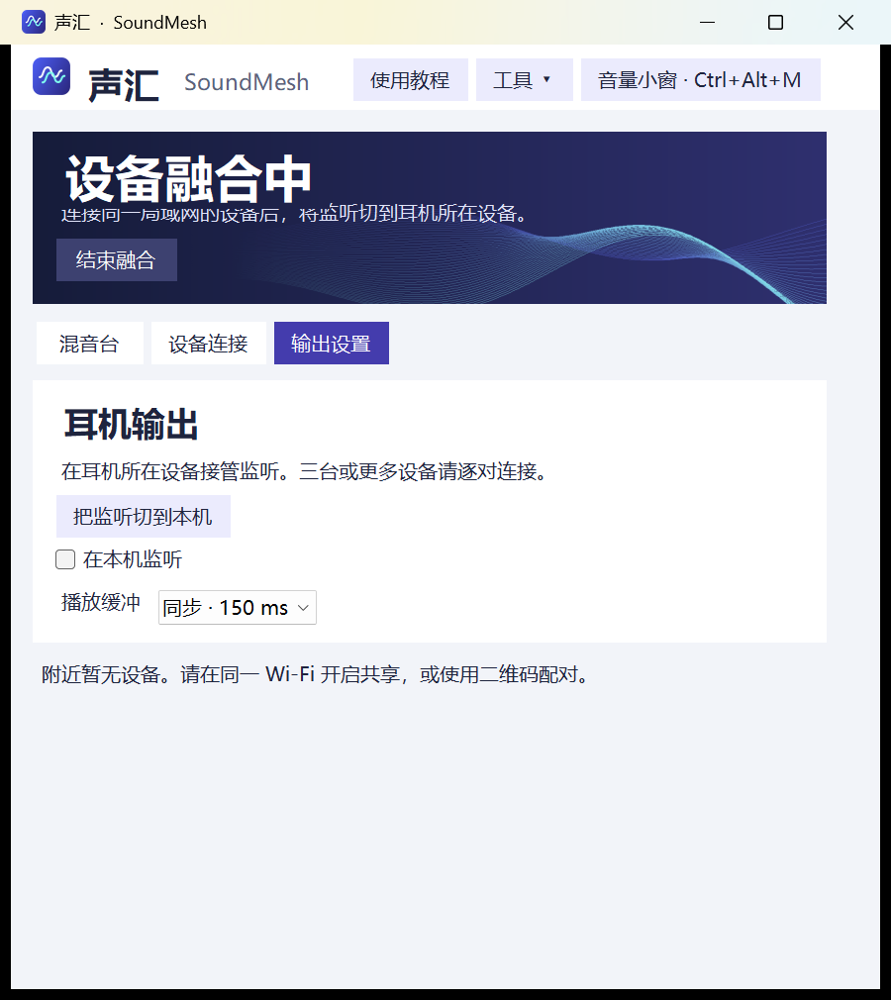

<div align="center">

# SoundMesh · 声汇

**One pair of headphones. Every device in the room.**

Windows · Android · iPhone (web preview) — one *Start fusion* both sends and receives, with timestamped multi-source playback at 48 kHz / 16-bit stereo over your LAN.

[](https://github.com/like-an-old-dog/SoundMesh/releases)
[](#platform-support)
[](#audio-latency-and-bandwidth)
[](#known-limitations)
[](NOTICE.md)

[中文](README.md) · [Quick start](#quick-start) · [How it works](#how-it-works) · [Build](#build-from-source)

</div>



---

## What it is

Your laptop plays music, your phone plays a video, your tablet plays a game — each one only through its own speaker. **SoundMesh captures the system audio of those devices, streams it across your local network, and mixes everything into one output on the device your headphones are plugged into.**

Since 1.1 there is only one mode: **Start fusion sends this device's audio and receives everyone else's at the same time.** Earlier versions made you choose between sharing and listening; now both ends press the same button and a single pairing connects both directions.

1.2 adds **timestamped playback**: the sender stamps every frame with its capture time and the receiver places all remote channels on one playout timeline, so devices no longer drift tens of milliseconds apart.

- 🎧 **All devices in one headphone** — headphones on the PC, the phone's audio joins them; headphones on the phone, the PC's audio joins them.
- 🎚️ **Four gain layers** — per remote device, all remotes combined, what this device sends, and local applications (Windows can scale other apps' volume proportionally).
- 📱 **System media card** — on Android, dragging the media progress bar in the notification shade *is* the remote mix volume; tapping it opens the full mixer panel.
- 🕒 **Aligned multi-source playback** — channels are sampled against a shared timeline; a late stream only loses its own slice.
- 🌐 **iPhone with nothing to install** — scan a QR code in Safari and listen.
- 📖 **Built-in offline guide** — seven HTML chapters reachable from Windows, Android and the iPhone web page before a fusion starts.
- 🩺 **Environment check** — *Tools → Check environment* sends 20 application-level probes to a LAN peer and reports success latency, timeouts, P95 and spread, which separates "network is broken" from "protocol is broken".
- 🔄 **In-app updates** — the app checks the latest GitHub release at startup, or on demand from *Tools → Check for updates*; downloads are verified by SHA-256, version and signer before installing. Windows keeps versions side by side under the user profile; Android hands the APK to the system installer.

> No account, no cloud, no relay: audio frames travel directly between devices inside the LAN. Traffic is **plaintext** — use it on networks you trust.

---

## What you can do with it

| Situation | What to do | Result |
| --- | --- | --- |
| **Headphones on the PC** | Both devices *Start fusion* and pair; on the PC tap *Move monitoring here* | Phone audio goes to the PC's headphones; PC audio keeps playing normally |
| **Headphones on the phone** | Same, but move monitoring to the phone | PC audio goes to the phone's headphones |
| **Watch together** | One device takes the monitor role, the others also *Start fusion* | One mixed output with per-source faders |
| **Three or more** | Connect each pair once (A–B, A–C, B–C) | Every device mixes the sources it is connected to |
| **Just try the iPhone** | PC → *Device connection* → *Invite iPhone browser listening* → scan | Plays in Safari, and can mix in other devices |

### Screens

| Mixer | Device connection |
| --- | --- |
|  |  |

| Output settings | Quick mixer (`Ctrl+Alt+M`) |
| --- | --- |
|  |  |

| iPhone browser listening (opened in Safari) |
| --- |
|  |

### Three things worth calling out

**Monitoring is separate from local playback.** Taking over monitoring only affects the audio arriving from other devices; everything else still goes straight to the system output. You never route your own computer's sound out and back just to hear a remote device.

**A sender never sends its own mix back out.** Windows captures with WASAPI process loopback from a separate `SoundMeshCapture.exe` process using `PROCESS_LOOPBACK_MODE_EXCLUDE_TARGET_PROCESS_TREE`; Android uses `AudioPlaybackCapture` with UID exclusion. Without that, B's audio would be re-encoded and sent back to B — a feedback loop.

**Synced playback and independent buffering are two different paths.** With 1.2 on both ends the timestamped protocol is used: five round trips pick the lowest-RTT clock sample on connect, re-probed every minute, and the receiver samples every channel from one playout timeline (100 / 150 / 200 ms, default 150). Peers on older versions or the iPhone web page fall back to **independent buffering**: 25 / 70 / 90 ms start, adaptive growth capped at 160 ms, oldest samples dropped when a queue overgrows.

---

## Platform support

| Platform | Status | Capture | Requirement |
| --- | --- | --- | --- |
| **Windows x64** | ✅ release | WASAPI process loopback (native helper) | Windows 10 / 11 x64 |
| **Android** | ✅ release | `MediaProjection` + `AudioPlaybackCapture` | Android 10 (API 29)+ |
| **iPhone web listening** | ⚠️ verified on desktop Chromium | bridged from the PC | iOS 16+ Safari, same LAN |
| **iOS native app** | 🧪 previous draft | ReplayKit Broadcast Upload | iOS 16+, sign it yourself in Xcode |

- *Start fusion* uses isolated capture on Windows and requires **build 20348+ (typically Win11)**; older builds are told so at startup.
- The Android 1.1 APK keeps the 1.0 signature, so it installs over 1.0 — and over 0.3.
- The protocol is unchanged since 0.2/0.3 and can talk to those versions; 0.1 was mono and is incompatible.

---

## Quick start

You need two or more devices on **one** LAN that can reach each other (guest Wi-Fi, AP isolation and enterprise networks usually cannot).

**Windows**: unzip the whole `SoundMesh-Windows-1.3.0.zip`, run `Windows\SoundMesh.exe`, and keep `SoundMeshCapture.exe` and `guide.html` **in the same folder**.
**Android**: install `SoundMesh-Android-1.3.0.apk`.

1. **Press *Start fusion* on every device** (Android will ask for the audio-sharing permission).
2. **Pair once**: pick the other device under *Nearby devices*, or scan its pairing QR code. One pairing covers both directions.
3. **On the device with the headphones, tap *Move monitoring here*.**

After that you only need steps 1 and 3.

| Symptom | Check first |
| --- | --- |
| *Nearby devices* stays empty | Same subnet? Windows Firewall allowing UDP 49633 and TCP 49632? |
| Address appears but connection fails | Multi-homed PC (Wi-Fi + Ethernet + VPN + virtual adapters): use manual pairing with the peer's LAN IP |
| Phone is `192.168.3.7`, PC shows `192.168.56.1` | The PC is on the wrong adapter — usually a VPN or VirtualBox NIC. *Device connection* lets you pick the address |
| Constant dropouts | Switch the buffer to *Stable · 90 ms*, and move off congested 2.4 GHz channels |
| Only one side has sound | Make sure the headphone device tapped *Move monitoring here* and *Monitor on this device* is checked |

Discovery is UDP broadcast on 49633; audio is TCP 49632. Traffic is plaintext — use it on networks you trust.

---

## Volume controls

| Fader | Effect |
| --- | --- |
| Each remote device | That source's level at the current listener, with its own mute |
| **All remotes** | Total gain of all remote channels (this is what the Android media card drags) |
| **This device sends** | Outbound level; every receiver hears the change |
| **Local applications** (Windows) | Proportionally lowers *other* apps on the default output, skipping SoundMesh's own session; restored when fusion ends |
| **Local · system media output** (Android) | System music volume for the current route, which also affects SoundMesh's own playback |

- **Windows**: `Ctrl+Alt+M` opens the quick mixer; the dropdown picks *remote mix / local applications / this device sends / a specific device*; `Esc` hides it.
- **Android**: expand the system media card and drag its progress bar for the remote mix; tap the card for the *SoundMesh volume* panel with local outbound, system media output, remote mix and per-device rows. Some OEM compact layouts hide the progress bar; Android 13+ needs notification permission.

> Android cannot mute other apps' local loudspeakers on its own, so *system media output* is the compromise — it lowers SoundMesh's playback as well. To keep capture level without speaker output, route the sender to an idle wired or USB audio device.

---

## Audio, latency and bandwidth

| Item | Value |
| --- | --- |
| Format | 48 000 Hz, 16-bit, stereo |
| Frame | 10 ms (1920 bytes) |
| Per-stream bitrate | ≈ **1.54 Mbps** plus protocol overhead |
| Synced playout buffer | 100 / 150 (default) / 200 ms, one shared timeline |
| Independent buffer (legacy peers) | 25 / 70 / 90 ms start, adaptive, capped at 160 ms |
| Reconnect backoff | 1 → 2 → 4 → 8 s |
| Concurrency | no protocol limit; 66 mixed sources stay in range in tests; real capacity depends on network and device |

End-to-end latency = system capture + network + receive buffer + system playback (+ the Bluetooth headset's own buffering). The progress bar in the UI shows **audio currently queued for playback**, not end-to-end latency.

---

## How it works

```mermaid
flowchart LR
  subgraph Device A (fusing)
    A1[System audio] --> A2[Capture<br/>WASAPI loopback / MediaProjection]
    A2 --> A3[48 kHz · 16-bit · stereo<br/>10 ms framing]
    A3 --> A4[(TCP 49632)]
  end
  subgraph LAN
    A4 <--> N[UDP 49633 discovery<br/>TCP 49632 audio]
  end
  subgraph Device B (fusing)
    N <--> B1[Adaptive buffer<br/>AudioRing]
    B1 --> B2[Per-source gain · mute]
    B2 --> B3[All remotes]
    B3 --> B4[Headphone output]
    N -.->|TCP 49634 HTTP + WebSocket| W[iPhone Safari<br/>Web Audio]
  end
```

| Purpose | Port | Form |
| --- | --- | --- |
| Discovery | UDP 49633 | broadcast `SOUNDMESH FIND 2`, reply `SM2\|<id>\|<name>` |
| Timestamped audio | TCP 49632 | SOUNDMESH3 <pin> [<reversePin>] → OK TIME3, then five PING clock probes; frames are 1928 bytes (8-byte timestamp + PCM) |
| Legacy audio | TCP 49632 | SOUNDMESH2 <pin> → OK 48000 2, 1920-byte PCM frames, independent buffering |
| Monitor handoff | TCP 49632 | SM2-FOCUS <pin> → OK FOCUS, asks the peer to pause monitoring |
| Clock re-probe | TCP 49632 | short-lived CLOCK connection, five clock exchanges |
| iPhone bridge | TCP 49634 | HTTP static assets + token-authenticated WebSocket; the token lives only in the URL fragment |

The pairing code is generated and stored locally by each device (Windows: `HKCU\Software\SoundMesh\Pairing`). QR codes carry a `soundmesh://pair/...` URI and never touch a third-party service. Protocol details: [docs/ARCHITECTURE.md](docs/ARCHITECTURE.md).

---

## Build from source

Full steps in [docs/BUILD.md](docs/BUILD.md).

**Windows client** (.NET 8 + NAudio + ZXing.Net, WinForms):

```powershell
dotnet publish src/windows/SoundMesh.csproj -c Release -r win-x64 --self-contained true `
  -p:PublishSingleFile=true -p:IncludeNativeLibrariesForSelfExtract=true -o Windows
```

**Windows capture helper** (needs the Windows 11 SDK): run `src\windows\native\build.cmd` from an *x64 Native Tools Command Prompt* and place the output next to the main executable.

**Android** (JDK 21 + SDK Platform 35 + Build Tools 35.0.0, no Gradle):

```powershell
./src/android/build.ps1 -AndroidJar 'C:/Android/sdk/platforms/android-35/android.jar' `
  -BuildTools 'C:/Android/sdk/build-tools/35.0.0'
```

**Tests**: `./src/tests/run.ps1 -CaptureSmoke`

**Icons and artwork**: `src/brand` holds the brand assets and `make_assets.py`, which generates the Windows multi-resolution icon, the Android adaptive launcher and the notification icon.

**iOS**: open `src/ios` with XcodeGen on a Mac — see [src/ios/README.md](src/ios/README.md). No IPA is included.

> The Android build script keeps a test signing key in the local `build/` directory. Building in a fresh directory produces a different key that **cannot** update an already-signed install.

---

## Verification

See [docs/TEST-RESULTS-1.3.0.txt](docs/TEST-RESULTS-1.3.0.txt). Highlights:

- **Two 1.2.1 fixes**: when the capture backlog suddenly grows the sender clock now continues from the previous block instead of jumping backwards, and the receiver range-checks the corrected timestamp, dropping blocks older than two seconds or newer than 50 ms.
- **The 1.2.2 guide**: the Windows ZIP and the APK ship the same seven-chapter offline HTML; the emulator verified opening it from home and returning, and a Chromium mobile viewport verified chapter navigation and returning to the mixer.

- **31 C# checks pass**, including the new outbound-gain checks: pre-roll, signed PCM conversion, bounded backlog, stale-sample discard, underrun silence, per-source/master/outbound gain composition, 66-source headroom, oversized-handshake and truncated-frame rejection, wrong-pairing rejection.
- **Cross-language interop** between the Android Java codec and the C# sender/receiver, including fragmented streams, disconnect detection, and mix settings surviving a forced reconnect.
- **Android 12L emulator**: the signed APK installed over 1.0; a real drag on the system media card moved the mix from 80 to 37 and was reported through the media session; tapping opened the volume panel; a landscape compact layout hid the system seek bar.
- **Windows**: the published x64 binary carries the multi-resolution icon; hotkey registration and `WM_HOTKEY` dispatch work, main and quick-mixer sliders stay in sync; process-excluding capture streamed 30 frames; WASAPI → local TCP receiver.
- **Sync**: two sources stay sample-aligned at 100 / 150 / 200 ms even when one repeatedly stalls for 80 ms; late slices are skipped and the next valid slice recovers; a reconnect clears the stale timeline.
- **Interop**: the Windows engine paired with the 1.2 Android client and exchanged 500 timestamped frames both ways with reverse connection, clock probe, timeline buffering and monitor handoff verified; the APK shares the 1.1 signing identity and installed over it.

Older logs are kept in [docs/TEST-RESULTS-1.1.txt](docs/TEST-RESULTS-1.1.txt).

---

## Known limitations

- ⚠️ **Sync only covers the remote SoundMesh tracks** — local apps, the iPhone web page and older peers do not join the shared timeline and use independent buffering.
- ⚠️ **iPhone is verified at the link layer only** — the web path works under desktop Chromium, but real Safari on a physical iPhone, background behaviour and Bluetooth latency are untested.
- ⚠️ **The native iOS app is a previous draft** — source only, never built, signed or installed on a device.
- ⚠️ **Not measured**: OEM notification layouts, real acoustic output level, Bluetooth multipoint arbitration, Wi-Fi jitter and end-to-end latency.
- ⚠️ **Plaintext transport** — pairing codes and audio are unencrypted on the LAN.
- ⚠️ **Android cannot mute other apps' speakers** — it can only lower system media volume, which also lowers SoundMesh.
- Protected media and phone calls cannot be captured.
- No fixed stream-count limit; capacity depends on network and device.

---

## Contributing

See [CHANGELOG.md](CHANGELOG.md) for version history and [docs/USAGE.md](docs/USAGE.md) for detailed operation. Please report security issues privately rather than in a public issue, and make sure `./src/tests/run.ps1` passes before opening a PR. The source package ships `.github/workflows/audio-ci.yml`; once it is in the repository, every push and PR runs the Windows build, JVM audio tests, C# tests and the cross-language protocol check.

## Authors

Designed, implemented and released by two authors:

- **like-an-old-dog** — [@like-an-old-dog](https://github.com/like-an-old-dog)
- **2222223233** — [@2222223233](https://github.com/2222223233)

## Copyright and third parties

**All rights reserved.** This is not an open-source licensed project: the source is public for reading and evaluation, but redistribution or commercial use requires written permission — see [NOTICE.md](NOTICE.md).

The layout follows Microsoft Fluent 2 spacing and grouping and Android Developers' Material card usage; **the icons and session wave artwork are original to SoundMesh**.

Bundled third-party components and their license texts are in [THIRD-PARTY/](THIRD-PARTY/): .NET 8 and Windows Desktop Runtime (MIT), NAudio 2.2.1 (MIT), ZXing.Net 0.16.11 (Apache-2.0), ZXing core (Apache-2.0).
