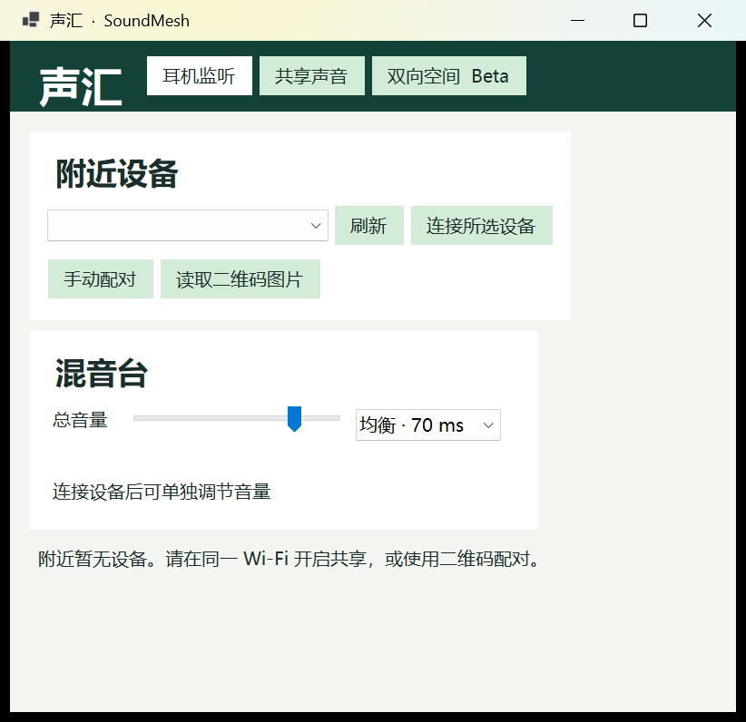
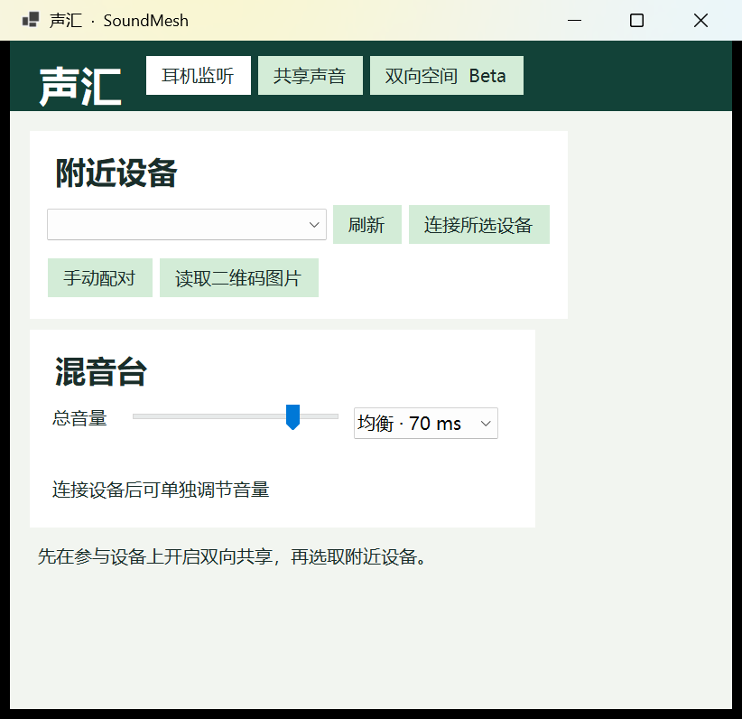
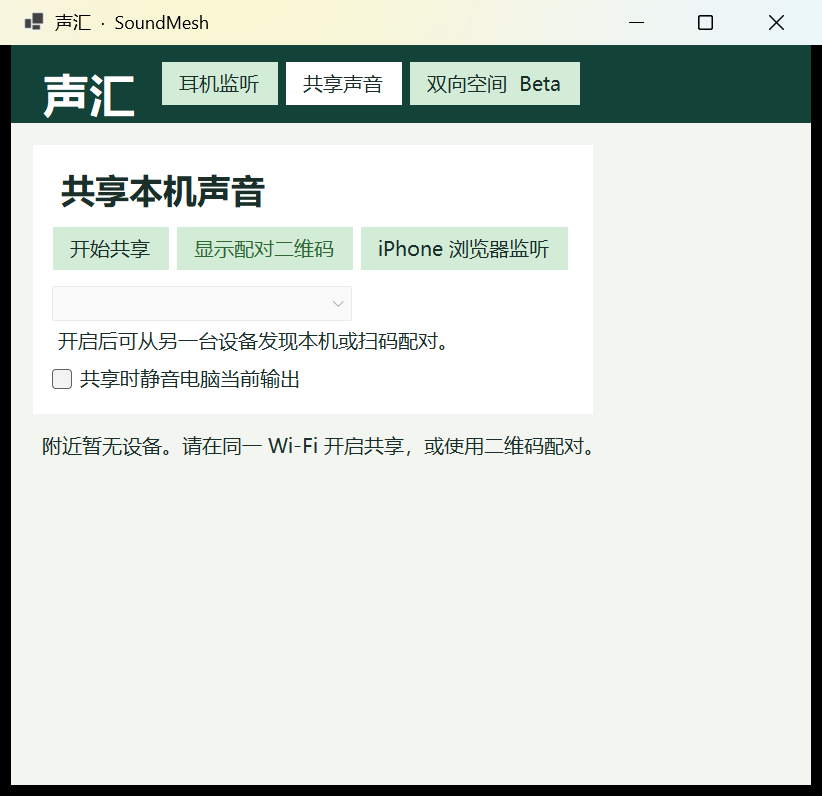
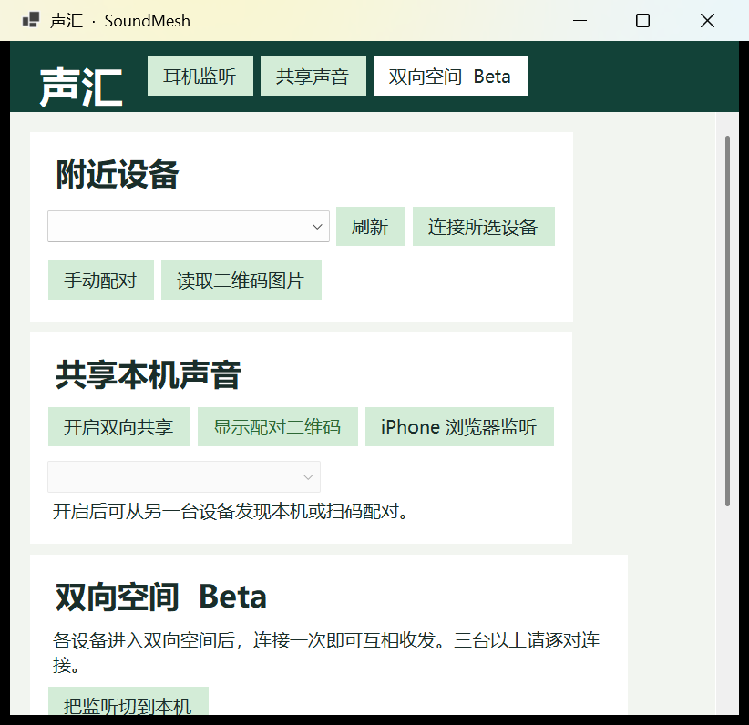
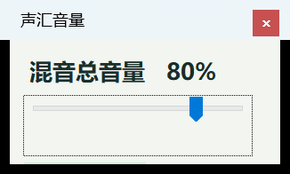
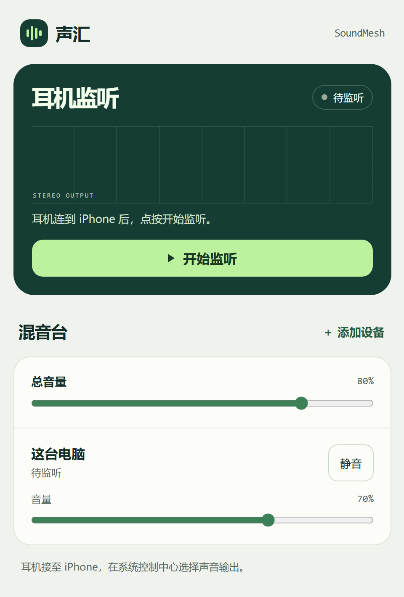
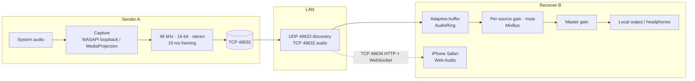

<div align="center">

# SoundMesh · 声汇

**One pair of headphones. Every device in the room.**

Windows · Android · iPhone (web preview) — 48 kHz / 16-bit stereo, low-latency multi-source mixing over your LAN.

[](https://github.com/like-an-old-dog/SoundMesh/releases)
[](#platform-support)
[](#audio-latency-and-bandwidth)
[](#known-limitations)
[](NOTICE.md)

[中文](README.md) · [Quick start](#quick-start) · [How it works](#how-it-works) · [Build](#build-from-source)

</div>



---

## What it is

Your laptop plays music, your phone plays a video, your tablet plays a game — each one only through its own speaker. **SoundMesh captures the system audio of those devices, streams it across your local network, and mixes everything into one output on the device your headphones are plugged into.**

Every device only does one of two things: **share its own audio**, or **receive and mix other devices' audio**. No account, no cloud, no relay server — audio frames travel directly from sender to receiver inside the LAN.

- 🎧 **All devices in one headphone** — headphones on the PC, the phone's audio joins them; headphones on the phone, the PC's audio joins them.
- 🎚️ **Per-source control** — independent volume and mute for each source, plus a master fader.
- 🔁 **Reconnects back into place** — channels and volumes survive short drops; retries back off 1, 2, 4, 8 s.
- 🌐 **iPhone with nothing to install** — open a QR code in Safari and listen. No IPA, no developer signing.

> SoundMesh is at **0.3 preview**. The core path works, but questions that only physical hardware can answer — real Wi-Fi jitter, Bluetooth headset latency, actual Safari playback on an iPhone — are not fully verified yet. See [Known limitations](#known-limitations).

---

## What you can do with it

| Situation | What to do | Result |
| --- | --- | --- |
| **Headphones on the PC** | PC enters *Headphone monitoring*; phone taps *Share this device's audio* | Phone audio goes to the PC's headphones; PC audio is untouched |
| **Headphones on the phone** | Phone receives, PC shares | PC audio goes to the phone's headphones |
| **Watch together** | Any device receives, the others share | One mixed output, per-source faders |
| **Both directions** | Both devices enter *Duplex Space Beta* and pair | A→B and B→A simultaneously, each end mixes independently |
| **Just try the iPhone** | PC: *Share audio* → *iPhone browser listening* → scan | Plays in Safari, and can mix in other devices |

### Screens

| Receive & mix | Share this device |
| --- | --- |
|  |  |

| Duplex Space Beta | Quick mixer (`Ctrl+Alt+M`) |
| --- | --- |
|  |  |

| iPhone browser listening (opened in Safari) |
| --- |
|  |

### Three things worth calling out

**Monitoring and local playback are separate.** A receiver only takes over the audio that arrives from other devices; the rest of the machine's audio still goes straight to the system. You never route your own computer's sound out and back just to hear a remote device.

**A sender never sends its own mix back out.** In duplex mode Windows captures with WASAPI process loopback from a separate `SoundMeshCapture.exe` process using `PROCESS_LOOPBACK_MODE_EXCLUDE_TARGET_PROCESS_TREE`; Android uses `AudioPlaybackCapture` with UID exclusion. Without that, B's audio would be re-encoded and sent back to B — a feedback loop.

**Buffering adapts.** The starting buffer depends on the profile (25 ms responsive / 70 ms balanced / 90 ms stable), grows when a stream underruns, and decays back once stable, capped at 160 ms. When a queue overgrows, old samples are dropped instead of letting latency creep up forever — the tradeoff is one audible skip under extreme jitter.

---

## Platform support

| Platform | Status | Capture | Requirement |
| --- | --- | --- | --- |
| **Windows x64** | ✅ installable | WASAPI process loopback (native helper) | Windows 10 / 11 x64 |
| Windows *mute local output while sharing* & duplex | ✅ | process loopback exclusion | Windows build 20348+ (typically Win11) |
| **Android** | ✅ installable | `MediaProjection` + `AudioPlaybackCapture` | Android 10 (API 29)+ |
| **iPhone web listening** | ⚠️ verified on desktop Chromium | bridged from the PC | iOS 16+ Safari, same LAN |
| **iOS native app** | 🧪 source project only | ReplayKit Broadcast Upload | iOS 16+, sign it yourself in Xcode |

**Interop**: 0.2 and 0.3 speak the same audio protocol and can connect to each other. 0.1 used mono and must pair with another 0.1. Treat two versions installed on one device as two separate installs.

---

## Quick start

You need two or more devices on **one** LAN that can reach each other (guest Wi-Fi, AP isolation and enterprise networks usually cannot).

1. **Receive**: on the device with the headphones, open *Headphone monitoring* (PC) or *Receive* (Android).
2. **Share**: on another device, tap *Share this device's audio* and grant the system capture prompt.
3. **Pair once**: pick the sender under *Nearby devices*, enter its **8-digit pairing code** (or scan its QR code). The same installation remembers the pairing afterwards.

Windows: unzip the whole `SoundMesh-Windows-0.3.zip` and run `SoundMesh.exe` from the **same folder** as `SoundMeshCapture.exe`; both files are required. Android: install `SoundMesh-Android-0.3.apk`; it keeps the 0.2 package name and signature, so it installs over the previous version.

| Symptom | Check first |
| --- | --- |
| *Nearby devices* stays empty | Same subnet? Windows Firewall allowing UDP 49633 and TCP 49632? |
| Address appears but connection fails | Multi-homed PC (Wi-Fi + Ethernet + VPN + virtual adapters): use manual pairing with the sender's LAN IP |
| Phone is `192.168.3.7`, PC shows `192.168.56.1` | The PC is on the wrong adapter — usually a VPN or VirtualBox NIC. The share page lets you pick the address |
| Constant dropouts | Switch the buffer profile to *Stable · 90 ms*, and move off congested 2.4 GHz channels |

Discovery is UDP broadcast on 49633; audio is TCP 49632. **Traffic is plaintext on the LAN** — use it on networks you trust.

---

## Audio, latency and bandwidth

| Item | Value |
| --- | --- |
| Format | 48 000 Hz, 16-bit, stereo |
| Frame | 10 ms (1920 bytes) |
| Per-stream bitrate | ≈ **1.54 Mbps** plus protocol overhead |
| Starting buffer | 25 ms (responsive) / 70 ms (balanced, default) / 90 ms (stable) |
| Adaptive ceiling | 160 ms |
| Reconnect backoff | 1 → 2 → 4 → 8 s |
| Concurrency | no protocol limit; 66 mixed sources stay in range in tests; real capacity depends on network and device |

End-to-end latency = system capture + network + receive buffer + system playback (+ the Bluetooth headset's own buffering). The progress bar in the UI shows **audio currently queued for playback**, not end-to-end latency.

---

## How it works



| Purpose | Port | Form |
| --- | --- | --- |
| Discovery | UDP 49633 | broadcast `SOUNDMESH FIND 2`, reply `SM2\|<id>\|<name>` |
| Audio | TCP 49632 | plaintext handshake `SOUNDMESH2 <pin> [<reversePin>]` → `OK 48000 2`, then fixed-size PCM frames |
| iPhone bridge | TCP 49634 | HTTP static assets + token-authenticated WebSocket; the token lives only in the URL fragment |

The pairing code is generated and stored locally by the sender (Windows: `HKCU\Software\SoundMesh\Pairing`). QR codes carry a `soundmesh://pair/...` URI and never touch a third-party service. Protocol details: [docs/ARCHITECTURE.md](docs/ARCHITECTURE.md).

---

## Build from source

Full steps in [docs/BUILD.md](docs/BUILD.md).

**Windows client** (.NET 8 + NAudio + ZXing.Net, WinForms):

```powershell
dotnet publish src/windows/SoundMesh.csproj -c Release -r win-x64 --self-contained true `
  -p:PublishSingleFile=true -p:IncludeNativeLibrariesForSelfExtract=true -o Windows
```

**Windows capture helper** (process loopback, needs the Windows 11 SDK): run `src\windows\native\build.cmd` from an *x64 Native Tools Command Prompt* and place the output next to the main executable.

**Android** (JDK 21 + SDK Platform 35 + Build Tools 35.0.0, no Gradle):

```powershell
./src/android/build.ps1 -AndroidJar 'C:/Android/sdk/platforms/android-35/android.jar' `
  -BuildTools 'C:/Android/sdk/build-tools/35.0.0'
```

**Tests**: `./src/tests/run.ps1 -CaptureSmoke`

**iOS**: open `src/ios` with XcodeGen on a Mac — see [src/ios/README.md](src/ios/README.md). No IPA is included; a Windows host cannot build, sign or verify one.

> The Android build script keeps a test signing key in the local `build/` directory. Building in a fresh directory produces a different key that **cannot** update an already-signed install.

---

## Verification

See [docs/TEST-RESULTS-0.3.txt](docs/TEST-RESULTS-0.3.txt). Highlights: 21 C# checks (pre-roll, PCM conversion, bounded backlog, stale-sample discard, underrun silence, gain/mute composition, 66-source headroom, oversized-handshake and truncated-frame rejection, wrong-pairing rejection); cross-language codec interop between Android Java and C#; a real signed APK installed over the previous version on an API 32 emulator with notification button `PendingIntent`s exercised; Windows process-excluding capture streaming 30 frames; jitter comparison (0.2: 2 underruns / 60 ms lost vs 0.3: 1 underrun / 50 ms lost over 14 s); a Kestrel + WebSocket + Web Audio playback path on desktop Chromium.

---

## Known limitations

- ⚠️ **iPhone is verified at the link layer only.** Playback works under desktop Chromium, but real Safari on a physical iPhone, background behaviour and Bluetooth latency are untested. The Windows WebKit runtime lacked `Web Audio`, so it is not a substitute.
- ⚠️ **Duplex Space is Beta.** Three physical devices, Bluetooth multipoint takeover and real acoustic latency have not been fully measured. Devices also **cannot send Bluetooth audio to each other** — a headset is only ever a system output.
- ⚠️ **The native iOS app is source only.** No Apple SDK, no Xcode signing, no device test.
- ⚠️ **Plaintext transport.** Pairing codes and audio are unencrypted on the LAN. No forward secrecy.
- ⚠️ **Android cannot reliably mute other apps' speakers.** A normal app cannot silence other apps' local loudspeakers while keeping full capture level; routing the sender to an idle wired or USB audio device is the practical workaround.
- Protected media and phone calls are restricted by the OS and cannot be captured.
- No fixed stream-count limit; capacity depends on network and device.

---

## Contributing

See [CHANGELOG.md](CHANGELOG.md) for version history and [docs/USAGE.md](docs/USAGE.md) for detailed operation. Please report security issues privately rather than in a public issue, and make sure `./src/tests/run.ps1` passes before opening a PR.

## Authors

Designed, implemented and released by two authors; the repository and release process are currently maintained by:

- **like-an-old-dog** — [@like-an-old-dog](https://github.com/like-an-old-dog)

## Copyright and third parties

**All rights reserved.** This is not an open-source licensed project: the source is public for reading and evaluation, but redistribution or commercial use requires written permission — see [NOTICE.md](NOTICE.md).

Bundled third-party components and their license texts are in [THIRD-PARTY/](THIRD-PARTY/): .NET 8 and Windows Desktop Runtime (MIT), NAudio 2.2.1 (MIT), ZXing.Net 0.16.11 (Apache-2.0), ZXing core (Apache-2.0).
