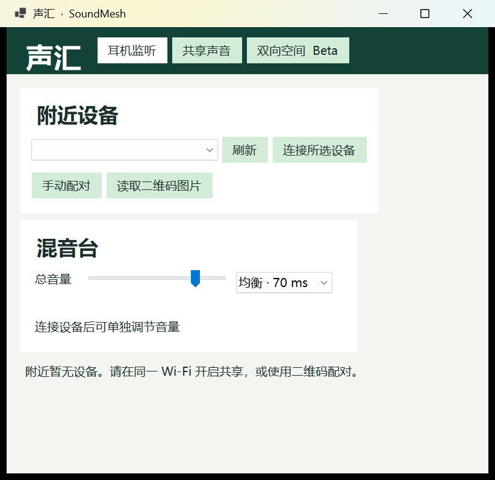
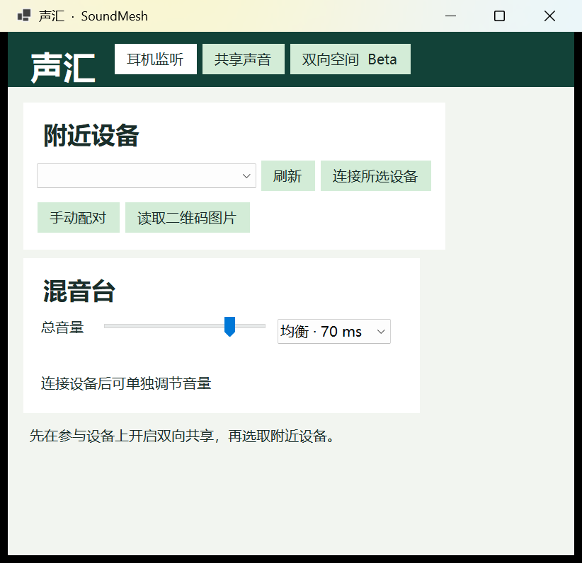
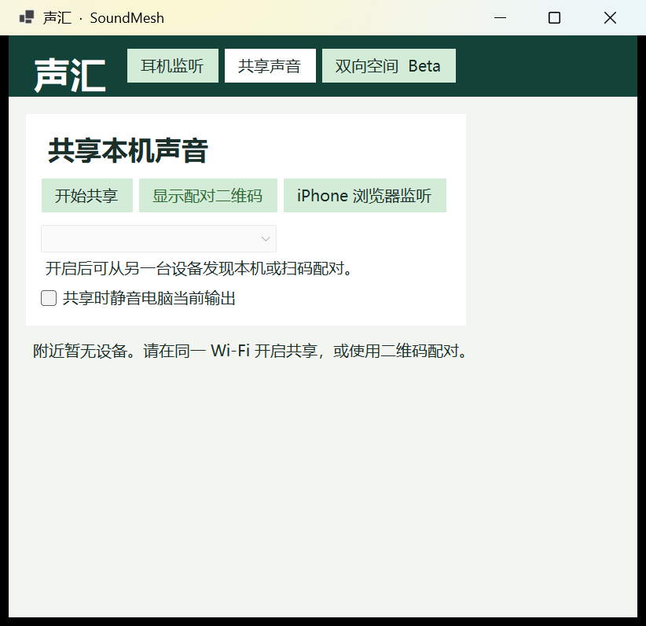
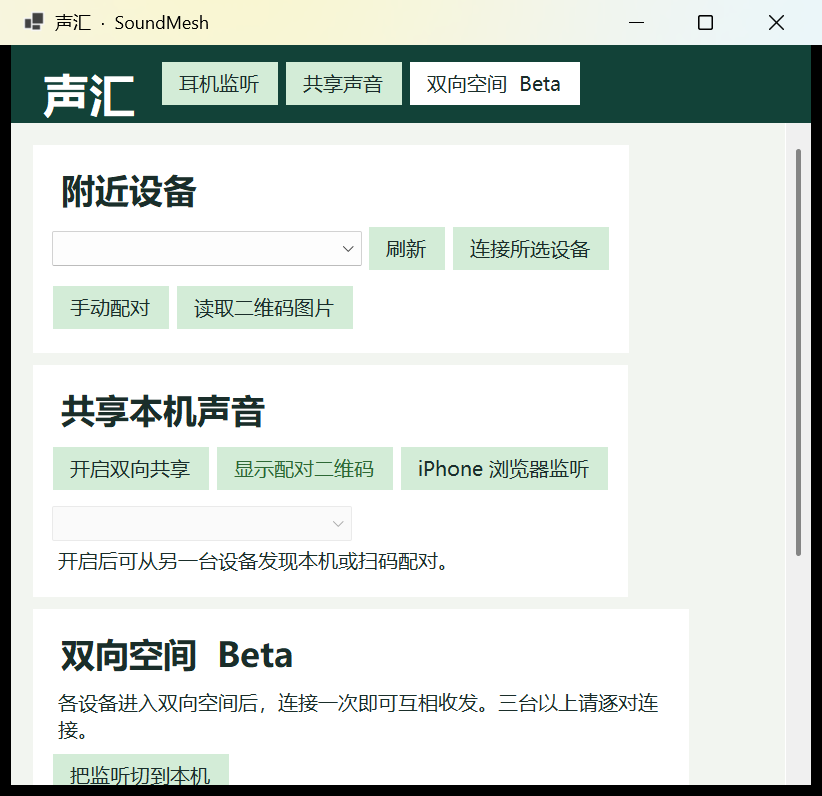
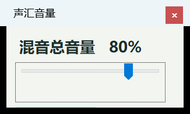
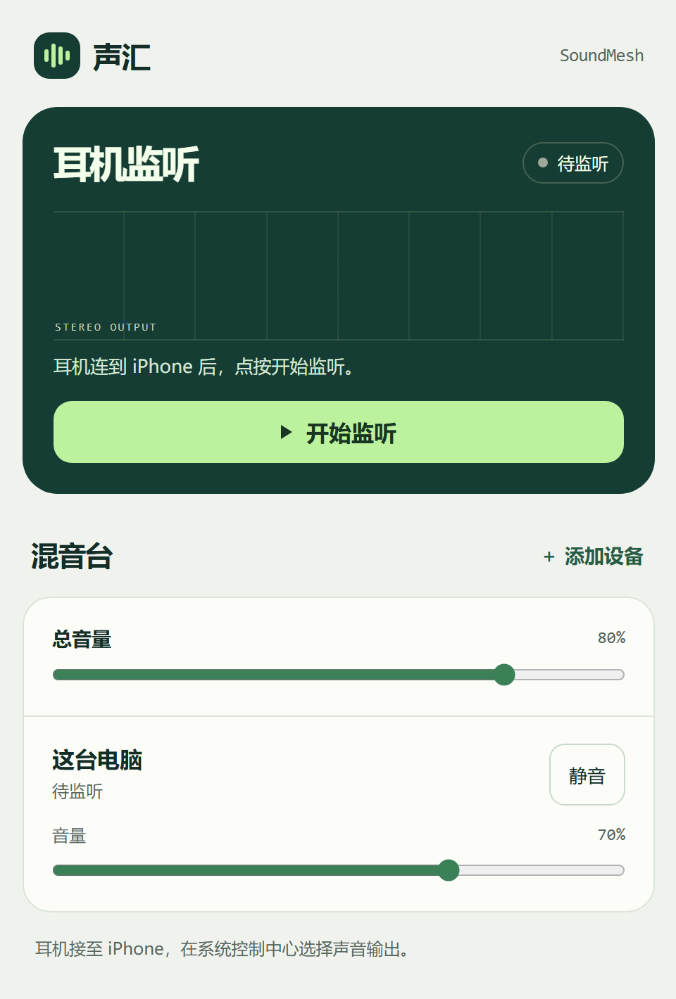
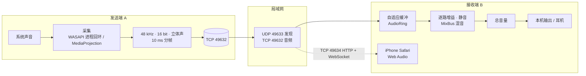

<div align="center">

# 声汇 · SoundMesh

**把同一个局域网里几台设备的声音，汇到一副耳机里。**

Windows · Android · iPhone 网页试听 —— 48 kHz / 16 bit 立体声，低延迟多路混音

[](https://github.com/like-an-old-dog/SoundMesh/releases)
[](#平台支持)
[](#音质延迟与带宽)
[](#已知限制)
[](NOTICE.md)

[快速开始](#快速开始) · [功能](#能做什么) · [工作原理](#工作原理) · [构建](#从源码构建) · [已知限制](#已知限制) · [English](README.en.md)

</div>



---

## 这是什么

电脑上的音乐、手机里的视频、平板上的游戏——通常它们各自只从自己的扬声器出声。**声汇 SoundMesh 把这些来自不同设备的声音收进同一条局域网音频链路，在一台设备上合成一路混音，送进你正戴着的那副耳机。**

每台设备只做两件事：**共享自己的声音**，或者**接收并混合别人的声音**。没有账号、没有云端、没有中转服务器，音频帧只在局域网内从发送端直连到接收端。

- 🎧 **一副耳机听所有设备**——电脑接耳机，手机声音也进耳机；手机接耳机，电脑声音也进手机。
- 🎚️ **逐路调音**——每台来源独立音量与静音，外加一个总音量。
- 🔁 **断线自动回到原位**——设备短暂掉线后保留通道和音量，按 1、2、4、8 秒重试。
- 🌐 **iPhone 免安装试听**——Safari 扫码即听，无需 IPA、无需开发者签名。

> 项目仍在 **0.3 预览阶段**：核心链路可用，但"真实 Wi-Fi 抖动、蓝牙耳机延迟、实体 iPhone 上 Safari 播放"这类只有实机才能回答的问题还没有全部验证。详见[已知限制](#已知限制)与 [测试结果](docs/TEST-RESULTS-0.3.txt)。

---

## 能做什么

| 场景 | 怎么做 | 结果 |
| --- | --- | --- |
| **耳机在电脑上** | 电脑开「耳机监听」，手机点「共享本机声音」 | 手机声音进入电脑耳机，电脑自己的声音不受影响 |
| **耳机在手机上** | 手机开接收，电脑开共享 | 电脑声音进入手机耳机 |
| **大家一起看片** | 任意台设备作为接收端，其余设备共享 | 一路混音同时输出，逐路调音量 |
| **两边都要听** | 两台设备都进入「双向空间 Beta」并互相连接 | A 的声音到 B、B 的声音到 A，两端各自混音 |
| **只想快速听一下 iPhone** | 电脑「共享声音」→「iPhone 浏览器监听」→ 扫码 | Safari 里直接播放，还能加别的设备一起混 |

### 界面

| 接收与混音 | 共享本机声音 |
| --- | --- |
|  |  |

| 双向空间 Beta | 音量小窗（`Ctrl+Alt+M`） |
| --- | --- |
|  |  |

| iPhone 浏览器监听（Safari 中打开） |
| --- |
|  |

### 三个值得单独说的点

**耳机监听 / 本机播放是分开的。** 接收端只接管"来自其他设备"的那部分声音，本机其他应用仍由系统直接播放。你不需要为了听远端的声音，把自己电脑的声音绕一圈再回来。

**发送端不会把自己的混音送回网络。** 双向模式下，Windows 用 WASAPI 进程回环采集并排除自身进程树（`SoundMeshCapture.exe` 独立进程，`PROCESS_LOOPBACK_MODE_EXCLUDE_TARGET_PROCESS_TREE`），Android 用 `AudioPlaybackCapture` 的 UID 排除。否则 A 听到的 B 会被再次编码发回 B，形成回声。

**缓冲是自适应的。** 起始缓冲按档位设置（灵敏 25 ms / 均衡 70 ms / 稳定 90 ms），一旦断流临时抬高，稳定一段时间后再逐步回落，上限 160 ms。积压时丢弃旧样本而不是越堆越慢——延迟不会随时间增长，代价是极端抖动下会有一次轻微断音。

---

## 平台支持

| 平台 | 状态 | 采集方式 | 系统要求 |
| --- | --- | --- | --- |
| **Windows x64** | ✅ 可安装使用 | WASAPI 进程回环（独立 native 进程） | Windows 10 / 11 x64 |
| Windows「静音本机输出」与双向模式 | ✅ | 进程级回环排除 | Windows build 20348+（通常 Win11） |
| **Android** | ✅ 可安装使用 | `MediaProjection` + `AudioPlaybackCapture` | Android 10（API 29）及以上 |
| **iPhone 网页监听** | ⚠️ 桌面 Chromium 已测 | 由电脑端桥接转发 | iOS 16+ Safari，同一局域网 |
| **iOS 原生 App** | 🧪 仅有源码工程 | ReplayKit Broadcast Upload | iOS 16+，需 Xcode 自行签名 |

**版本互连规则**：0.2 与 0.3 的音频协议兼容，可以互相连接；0.1 使用单声道协议，必须与同为 0.1 的设备配对。同一设备上运行的两个版本请当作两套独立安装。

---

## 快速开始

### 你需要

- 两台以上设备接在**同一个** Wi-Fi / 有线局域网，且彼此能互相访问（访客 Wi-Fi、AP 隔离、企业网络常见地不行）。
- Windows 上：解压整个 `SoundMesh-Windows-0.3.zip` 后，运行与 `SoundMeshCapture.exe` **同目录**的 `SoundMesh.exe`。两个文件缺一不可。
- Android 上：安装 `SoundMesh-Android-0.3.apk`。沿用 0.2 的包名与签名，可直接覆盖安装。

### 三步连起来

1. **一边接收**：在耳机所接的设备上打开「耳机监听」（电脑）或「接收」（手机）。
2. **另一边共享**：在另一台设备点「共享本机声音」，同意系统的采集授权。
3. **配对一次**：在接收端的「附近设备」里选中发送端；首次输入对方界面上的 **8 位配对码**（或扫二维码）。同一安装之后会自动记住。

之后只需要第 1、2 步。

### 如果连不上

| 现象 | 先检查 |
| --- | --- |
| 「附近设备」一直是空的 | 两端是否真的在同一子网；Windows 防火墙是否放行 UDP 49633 与 TCP 49632 |
| 列表里显示了地址，却连不上 | 电脑有多块网卡（无线/有线/VPN/虚拟网卡）时，尝试用「手动配对」直接填发送端的局域网 IP |
| 手机是 `192.168.3.7`，电脑却显示 `192.168.56.1` | 电脑连错网卡了，多半是 VPN 或 VirtualBox 虚拟网卡。共享页可以手动改选地址 |
| 时断时续 | 把缓冲档位切到「稳定 · 90 ms」，并远离 2.4 GHz 拥塞信道 |

发现走 UDP 广播 49633，音频走 TCP 49632。链路是**明文局域网传输**，请只在可信网络使用。

---

## 音质、延迟与带宽

| 项目 | 数值 |
| --- | --- |
| 采样格式 | 48 000 Hz，16 bit，立体声 |
| 音频帧 | 10 ms / 帧（1920 字节） |
| 单路码率 | ≈ **1.54 Mbps** + 协议开销 |
| 可选起始缓冲 | 25 ms（灵敏） / 70 ms（均衡，默认） / 90 ms（稳定） |
| 自适应上限 | 160 ms |
| 断线重试 | 1 → 2 → 4 → 8 s 指数退避 |
| 并发路数 | 协议不设上限；实测混音 66 路不削波，真实容量取决于网络与设备 |

端到端延迟 = 系统采集 + 网络 + 接收缓冲 + 系统播放（+ 蓝牙耳机自身缓冲）。界面里的进度条显示的是**接收队列中当前积压的音频时长**，不是端到端延迟。

---

## 快捷调音

- **Android**：接收或双向模式下，通知栏会出现 −5% / 静音·恢复 / +5% 三个按钮，与应用内总音量同步（仅作用于声汇混音）。Android 13+ 需允许通知。
- **Windows**：运行期间按 `Ctrl+Alt+M` 呼出音量小窗，`Esc` 收起；主窗口也有「音量小窗」按钮。

---

## 工作原理



**协议概要**（细节见 [docs/ARCHITECTURE.md](docs/ARCHITECTURE.md)）：

| 用途 | 端口 | 形式 |
| --- | --- | --- |
| 设备发现 | UDP 49633 | 广播 `SOUNDMESH FIND 2`，应答 `SM2\|<id>\|<name>` |
| 音频传输 | TCP 49632 | 明文握手 `SOUNDMESH2 <pin> [<reversePin>]` → `OK 48000 2`，随后为定长 PCM 帧 |
| iPhone 桥接 | TCP 49634 | HTTP 静态资源 + 带令牌的 WebSocket，令牌只存在于 URL fragment |

配对码是发送端本地生成并持久化的 8 位数字，保存在 Windows 注册表 `HKCU\Software\SoundMesh\Pairing`（Android 等价存于私有偏好）。二维码内容是 `soundmesh://pair/<id>/<ip>/<pin>/<token>` 形式，扫描不经过任何第三方服务。

---

## 从源码构建

完整步骤见 [docs/BUILD.md](docs/BUILD.md)，这里是最短路径。

**Windows 客户端**（.NET 8 + NAudio + ZXing.Net，WinForms）：

```powershell
dotnet publish src/windows/SoundMesh.csproj -c Release -r win-x64 --self-contained true `
  -p:PublishSingleFile=true -p:IncludeNativeLibrariesForSelfExtract=true -o Windows
```

**Windows 采集进程**（进程回环，需要 Windows 11 SDK）：在 *x64 Native Tools Command Prompt* 中执行 `src\windows\native\build.cmd`，把产出的 `SoundMeshCapture.exe` 放到主程序旁边。

**Android**（JDK 21 + SDK Platform 35 + Build Tools 35.0.0，无需 Gradle）：

```powershell
./src/android/build.ps1 -AndroidJar 'C:/Android/sdk/platforms/android-35/android.jar' `
  -BuildTools 'C:/Android/sdk/build-tools/35.0.0'
```

**测试**：

```powershell
./src/tests/run.ps1 -CaptureSmoke
```

**iOS**：在 Mac 上用 XcodeGen 打开 `src/ios`，详见 [src/ios/README.md](src/ios/README.md)。仓库里不含 IPA——Windows 环境无法生成、签名或验证 iOS 包。

> 构建脚本会把测试签名密钥留在本机 `build/` 目录。换一台机器或换一个目录重新构建会得到不同密钥，**无法覆盖安装**已有版本的 APK。

---

## 测试与验证

已通过的自动化与实机检查（日志见 [docs/TEST-RESULTS-0.3.txt](docs/TEST-RESULTS-0.3.txt)）：

- 21 项 C# 检查：预缓冲、PCM 转换、积压上限、陈旧样本丢弃、欠载静音、逐路与总增益组合、66 路混音不越界、总静音、超大握手与截断帧拒绝、错误配对拒绝。
- 跨语言互通：Android Java 编解码器 ↔ C# 发送端/接收端，分片流与断连检测。
- Android API 32 模拟器实测：签名 APK 覆盖安装、通知栏四个音量按钮触发真实 `PendingIntent`、媒体播放采集、Beta 反向链路（ADB 端口转发）。模拟测试音为左 500 Hz / 右 900 Hz，8 秒采集的 800 个音频块均检测到正确的双声道频率。
- Windows：进程排除采集连续 30 帧、WASAPI → 本地 TCP 接收端、热键注册与 `WM_HOTKEY` 派发、主界面滑杆与小窗双向同步。
- 抖动对比（14 s 规律性 50–90 ms 卡顿）：0.2 欠载 2 次 / 缺失 60 ms；0.3 欠载 1 次 / 缺失 50 ms。
- 网页链路：真实 Kestrel 桥接接收合成立体声 PCM，经 WebSocket 与 Web Audio analyser 播放，逐声道静音与暂停均验证。

---

## 已知限制

**这是 0.3 预览版，请按"能用但还没打磨完"来对待。**

- ⚠️ **iPhone 只验证到链路层**：桌面 Chromium 上播放链路通过，但实体 iPhone Safari 的实际播放、后台行为、蓝牙延迟尚未验证。Windows 的 WebKit 测试运行时缺少 `Web Audio`，所以不能替代真机结论。
- ⚠️ **双向空间是 Beta**：三台实体设备、蓝牙多点耳机接管、真实声学延迟都还没有完整实测。设备间也**不支持直接蓝牙音频传输**——蓝牙耳机只能作为系统输出。
- ⚠️ **iOS 原生 App 只有源码**：工程结构与 entitlement 已检查，但没有 Apple SDK、Xcode 签名，也没有装机测试。
- ⚠️ **测试场景不含真实网络抖动**：没有实体 Wi-Fi 抖动、相机扫码、耳机听感与蓝牙延迟测量。
- ⚠️ **明文传输**：配对码与音频都在局域网明文传输，无加密、无前向保密。请在可信网络使用。
- ⚠️ **Android 无法可靠静音其他应用的扬声器**：普通应用做不到"只静音其他应用的本地扬声器、同时保留完整采集音量"。工程上可行的办法是把发送端媒体路由到闲置的有线耳机或 USB 声卡。
- Android 受保护的媒体内容与通话声音受系统限制，无法采集。
- 没有固定的并发路数上限，实际容量取决于网络与设备。

---

## 路线图

- [ ] iPhone Safari 真机验证，并补齐 Web Audio 的自动播放策略处理
- [ ] iOS 原生版：签名流程、TestFlight 分发、ReplayKit 采集验证
- [ ] 双向空间从 Beta 转正：三设备拓扑与蓝牙多点耳机接管实测
- [ ] 可选的链路加密（局域网内仍不依赖服务器）
- [ ] 安装包体积优化（当前 Windows 单文件自包含 ≈ 189 MB）

---

## 参与

- 版本变化见 [CHANGELOG.md](CHANGELOG.md)，使用细节见 [docs/USAGE.md](docs/USAGE.md)。
- 漏洞与安全问题请先私下联系作者，不要直接开公开 issue。
- 提交前请确认 `./src/tests/run.ps1` 通过。

## 作者

本项目由两位作者共同设计、实现与发布，当前由下列作者维护仓库与发布流程：

- **like-an-old-dog** — [@like-an-old-dog](https://github.com/like-an-old-dog)

## 版权与第三方组件

本项目**保留所有权利**（All Rights Reserved），未采用开源许可证。源码公开用于阅读与评估，未经作者书面许可不得再分发或用于商业用途，详见 [NOTICE.md](NOTICE.md)。

第三方组件及其许可证全文见 [THIRD-PARTY/](THIRD-PARTY/)：.NET 8 与 Windows Desktop Runtime（MIT）、NAudio 2.2.1（MIT）、ZXing.Net 0.16.11（Apache-2.0）、AndroidX/ZXing core（Apache-2.0）。
