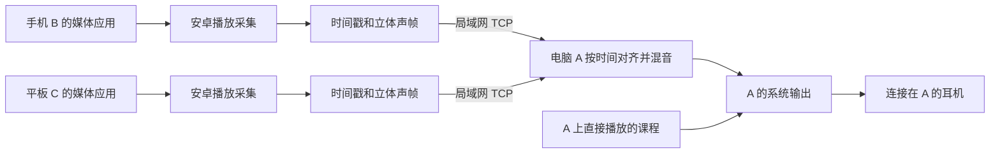

# 声汇 SoundMesh｜产品方案、使用方法与工程手册

**版本 1.3.0 · Android versionCode 10 · 整理日期 2026-11-25**

声汇让一副耳机同时听到多台设备的声音。例如，笔记本在播放课程，安卓手机在播放消息语音，耳机只连笔记本。声汇把手机的媒体声音通过局域网送到笔记本，笔记本将收到的声音送往系统输出。你可以在电脑上单独调小手机这一轨，并继续听课程。有第三台平板时，它也能加入同一个使用场景。

初次试用从第 2 节开始。遇到「8 秒后重试」直接看第 6 节。需要维护程序或发布新版时，看第 8 至 10 节。

**目录**　[平台与边界](#platforms) · [首次使用](#start) · [设备和音量](#mix) · [连接与协议](#network) · [采集、同步与混音](#audio) · [环境检测与排障](#diagnosis) · [iPhone 路径](#iphone) · [构建与代码](#build) · [GitHub 发布与更新](#release) · [验证与限制](#tests)

<a id="platforms"></a>

## 1. 哪些设备能做什么

| 设备或环境 | 当前能力 | 使用条件 |
|---|---|---|
| Windows 电脑 | 本机媒体采集、双向传输、多路混音、监听接管、快捷键调音、环境检测、更新、iPhone 网桥 | x64，系统 build 20348 或更新，常见适用系统为 Windows 11。用 `winver` 可查看版本。主程序需要同目录的采集助手 |
| 安卓手机、安卓平板 | 采集允许录制的应用声音，与电脑或其他安卓设备双向连接，在本机或耳机播放，通知栏调音 | Android 10 及以上。共享应用声音需系统授权，Android 13 及以上要显示通知控件还需允许通知 |
| iPhone Safari | 经同网段 Windows 电脑接收多路音频，在网页上调音、静音和播放 | Windows 开启网页邀请，iPhone 扫码并手动点播放。网页使用期间保持前台。桌面 Chromium 已验证，iPhone 真机体验待验证 |
| iOS 原生开发稿 | SwiftUI 监听端和 ReplayKit 应用音频广播扩展源码 | 目标 iOS 16 及以上。需 Mac、Xcode、签名和 App Group。当前交付为开发源码，尚无已签名并实测的 IPA |

Windows 和安卓正式版均以「开始融合」进入双向会话。局域网可以是同一个 Wi-Fi、互通的有线与无线网络，或一台设备提供的热点。**音频数据直接在设备之间传输。GitHub 用于分发程序。** 配对信息与局域网音频使用明文传输，适用范围是可信、允许终端互访的网络。

蓝牙耳机作为手机或电脑的系统输出设备。声汇将多路声音汇到耳机当前连接的一端，实际蓝牙路由和耳机多点策略由系统及耳机决定。设备之间使用 IP 传输。蓝牙网络共享若能形成互通的 IP 网络，可作为实验连接方式，现有测试没有覆盖它。

<a id="start"></a>

## 2. 从零开始，让电脑耳机听到手机音乐

| 步骤 | 在哪里操作 | 动作和成功标志 |
|---|---|---|
| 1. 安装 | 电脑、手机 | 电脑完整解压 Windows ZIP，运行 `Windows/SoundMesh.exe`，同目录保留 `SoundMeshCapture.exe` 和 `guide.html`。手机安装 APK。打开后可从首页顶部进入「使用教程」 |
| 2. 准备网络和耳机 | 两台设备 | 接入能彼此访问的局域网。耳机连到电脑，在 Windows 输出设备列表中选中耳机。先用电脑自身音频确认耳机能响 |
| 3. 建立会话 | 两台设备 | 各点一次「开始融合」。安卓按提示允许媒体音频采集。进入「设备连接」可以查看本机局域网地址和八位配对码 |
| 4. 配对 | 电脑 | 「设备连接 → 刷新」，选择手机，再点「连接所选设备」。首次输入**手机上**的八位码。另一方向由应用在握手后建立，无须再手输一次 |
| 5. 接管监听 | 电脑 | 打开「输出设置 → 把监听切到本机」。到「混音台」查看手机通道，确认未静音，远端总音量大于零 |
| 6. 验收 | 手机播放、电脑调音 | 手机播放一段允许采集的音乐。电脑耳机应能听到。再让电脑也播放声音，单独静音手机那一行。耳机中手机声应消失、电脑声应继续，恢复该行后手机声应回来 |

**搜不到时有两条配对路径。** 安卓可在声汇中点「扫码连接」，扫描对端「显示配对二维码」生成的原生配对码。Windows 支持读取二维码图片。也可以用「手动配对」，填写对端当前使用的局域网 IPv4 和八位码。多网卡电脑要选与手机互通的 Wi-Fi 或以太网地址。手动输入正确 IP 可以绕过广播发现失败，仍需要 TCP 直连成功。

**三台设备逐对配对。** 设电脑为 A、手机为 B、平板为 C。分别建立 A–B、A–C、B–C 三对连接。耳机接 A 时，A 接收 B 和 C 的声音。想换到 C，先把耳机切到 C 的系统输出，再在 C 点「把监听切到本机」。C 会通知已连对端暂停声汇监听。若某台当时离线，注意查看切换结果。结束时点「结束融合」，仅想移除一路时，在该设备卡片上点移除或断开。

<a id="mix"></a>

## 3. 音量控制的作用范围

同一台手机在声汇里有两个身份：它可以**向外发送本机声音**，也可以**在自己的耳机里播放远端声音**。下面以耳机接在 A、B 为远端手机为例。

| 你想改变的声音 | 操作位置 | 哪些人会听到变化 |
|---|---|---|
| A 耳机里的 B 太响 | A 的「混音台 → B」滑杆或静音 | 只改变 A 的 B 通道。C 听 B 时有自己的滑杆 |
| B 发给所有人的声音太响 | B 的「本机发送」或「本机 · 发给其他设备」 | 所有接收 B 的设备 |
| A 耳机里所有远端都太响 | A 的「其他设备合计」或「远端混音总音量」 | 一起改变 A 收到的远端混音，保留各路之间的比例 |
| Windows 上原应用太响 | 该电脑的「本机应用」 | 调节默认输出上其他应用的音频会话，跳过声汇自己的会话。保留原有比例，正常结束时恢复受管理的设置。应用会话的变化也可能影响被采集的信号 |
| 安卓手机外放太响 | 该手机的「本机 · 系统媒体输出」 | 改变当前路由的系统媒体音量，也会影响该耳机中的声汇播放。部分机型的采集电平随系统音量一起变化。固定音量设备会禁用此控件 |

**随时调音。** Windows 会话中按 `Ctrl+Alt+M` 显示或收起小窗，选择目标设备后拖动，`Esc` 收起。快捷键被占用时可点主窗口的「音量小窗」。安卓下拉并展开声汇媒体卡片，拖动滑杆调**远端混音总音量**。轻点卡片打开面板，可拖动本机和每台远端的滑杆。部分厂商的紧凑布局会隐藏滑杆。系统媒体卡片借用可拖动的进度控件表达 0–100%，有的系统会同时显示时间刻度，卡片标题显示实际百分比。

**发送端还会外放的原因。** 采集与原应用播放同时发生。尤其在安卓上，能否仅关扬声器而保留完整的远端采集音量取决于系统音频策略。可以降低本机媒体音量并在接收端试听。如果两端一起变小，可把发送端原应用的输出切到闲置的有线耳机或 USB 音频设备。

<a id="network"></a>

## 4. 数据怎样从一台设备到另一台



图中画出耳机在 A 的收听方向。A 同时可以采集自己的应用音频并分别发给 B、C。每个节点发送自己的来源，收到的远端混音由自己的播放器输出。Windows 和安卓在采集时排除声汇的播放，避免声音绕一圈又被当作新来源送回来。

| 用途 | 端口与报文 | 实际行为 |
|---|---|---|
| 发现附近设备 | UDP 49633，查询 `SOUNDMESH FIND 2`，回复 `SM2\|设备ID\|名称` | 从回复的来源 IP 建立连接，减少误选虚拟网卡。发现信息不包含配对码 |
| 建立音频连接 | TCP 49632，优先请求 `SOUNDMESH3 <对端码> [本机反向码]`，成功回复 `OK TIME3` | 握手为换行结尾的 ASCII。接收方主动向声音来源建立连接。反向码让对端再建立一条返回方向的音频流 |
| 兼容旧端 | `SOUNDMESH2`，成功回复 `OK 48000 2` | 传输连续 PCM，按完整音频块读取。此路径按该路自身的缓冲水位播放 |
| 校时、监听接管 | `PING`，定期 `SM3-CLOCK`。接管用 `SM2-FOCUS` | 校时对齐单调时钟。接管请求经配对码校验，随后对端暂停监听 |
| 环境检测 | 同一 TCP 49632，`SM-DIAG1` → `SM-READY1` | 检查指定端口上的声汇能否应答，无需先成功配对，也不会创建音频订阅 |
| 网页监听 | Windows 的 HTTP/WebSocket，TCP 49634 | Windows 为 Safari 提供网页和音频桥接，网页持本次邀请凭据访问 |

**规模与带宽。** 每台原生设备独立维护其连接。全互连的 N 台设备需要 N×(N−1)/2 对配对。三台时有三对连接，全部双向传音有六条单向流。每路 PCM 净载荷为 48,000 × 2 声道 × 16 bit，即 **1.536 Mbps**。三台全互连约 **9.216 Mbps**，另计时间戳、TCP/IP 和 Wi-Fi 开销。设备列表不设固定业务上限，实际容量会受无线竞争、CPU 调度和系统资源限制。

<a id="audio"></a>

## 5. 采集、同步和混音的具体做法

### 5.1 两端采集与音频格式

Windows 启动同目录的 C++ 助手 `SoundMeshCapture.exe`。助手用 WASAPI 进程回环采集，排除声汇进程树，将 PCM 写回主程序。普通设备回环可能将收到的远端声音再录进去，所以正式双向入口要求系统支持进程隔离采集。旧 Windows 10 出现采集启动失败时，应先核对系统 build 和助手是否完整。

安卓由前台服务持有 MediaProjection 授权，以 AudioPlaybackCapture 配置和 AudioRecord 采集媒体、游戏等允许捕获的播放声音，并排除本应用 UID。此链路读取应用播放音频，麦克风可保持关闭。通话、受保护内容或主动禁止捕获的应用可能无声。安卓用 AudioTrack 输出，Windows 用 NAudio 的 WaveOutEvent 输出。Windows 的请求播放延迟为 45 ms，使用三个缓冲区。

统一格式为 **48 kHz、16 位有符号小端 PCM、双声道交错排列**。每块 10 ms，含每声道 480 个采样、960 个左右声道样本，共 1,920 字节。时间戳协议在 PCM 前附 8 字节大端微秒时间戳，共 1,928 字节。TCP 是字节流，接收端要读满整块才解码。发送端先应用「本机发送」增益，再把数据交给各订阅者。

### 5.2 不同设备如何找到同一个播放时刻

1. **估计采集时刻。** Windows 用单调时钟结合采集缓冲中已有的音频时长估算块的起点。安卓依据读完一块的时刻回推块长。这些值是软件估计，不含声学传播测量。
2. **处理采集积压。** 每发一块，预计的下一块时间前进 10,000 微秒。估计时刻小幅变化时，每块最多修正 ±100 微秒。估计值大幅倒退超过 50 ms 时，继续沿已经发出的音频时间前进，避免后续正常帧被当成旧帧。明显的正向中断可以重新定位。
3. **估计时钟偏移。** 新协议握手后做五次时钟探测。设接收端发出请求和收到回复的时刻分别为 t₁、t₂，发送端返回的单调时刻为 S。偏移估计为 (t₁+t₂)/2−S，取往返时间最短的一次。此后约每分钟复测，单次偏移调整限在 ±2,000 微秒。网络上下行不对称、时钟长期漂移都会影响精度。
4. **校验并写时间轴。** 将对端块的时刻加偏移，得到本地时间。越界、溢出风险或偏离到达时刻过大的帧会被丢弃。当前允许窗口为到达前 2 秒至到达后 50 ms。每路用约 2 秒的时间轴容量记录立体声采样，标签区分环形存储中不同时间的内容。
5. **按同一时刻取样。** 在一个播放回调内，混音器只计算一次目标时间，将所有参与同步的远端通道按同一采样位置读取。以默认档为例，在本地单调时刻 10.000 秒处理一批输出时，目标约为 9.850 秒。两台设备的包可以一早一晚到达，只要赶上播放期限，仍能落入同一个时间片。
6. **处理缺口。** 当相邻块起点间隔是 470–490 个采样帧时，将前一块轻微重采样到此间隔。间隔差得更多时保留真实缺口，避免将一个正常音块过度拉长。缺音开始和恢复时分别用约 96 个采样帧、即 2 ms，平滑音量边缘。超过期限的旧帧不追播，其他有数据的通道继续播放。

**为何默认等待 150 ms。** 它给突发补包留出时间。若一次中断长于剩余播放余量，仍可能缺音。端到端还包含采集、设备调度、网络、播放缓冲及蓝牙编解码。100/150/200 ms 描述声汇的目标等待时间。**本机应用的直接播放、旧协议通道、Safari 网页链路**各有自己的时间路径。

| 接收端设置 | 适用场景 | 调整方法 |
|---|---|---|
| 同步 150 ms | 首次连接，多台新版设备共同播放 | 先用这一档，播放有语音和音乐的固定片段，记录断流计数 |
| 同步 200 ms | Wi-Fi 时有停顿，断流计数持续增加 | 只改耳机所在设备，重播同一片段，比较新增断流和听感 |
| 同步 100 ms | 声音稳定，但看视频觉得声音偏晚 | 降到 100 ms 试听，断流明显增加时调回 |
| 灵敏 25 / 均衡 70 / 稳定 90 ms | 希望使用各路独立缓冲，或与旧设备兼容 | 独立缓冲按水位起播，欠载后会临时多等一段。旧协议在同步档下也走独立缓冲 |

### 5.3 怎样把多路音频合成一次输出

对每个采样位置，将各远端通道乘以独立增益后相加，再乘以远端总增益。静音通道的增益为零。比如手机一路的当前值为 0.4、独立音量为 50%，平板一路为 0.2、独立音量为 100%，总音量为 80%，则限幅前的混音为 **(0.4×0.5 + 0.2×1.0)×0.8 = 0.32**。左右声道分别计算。如果相加后的峰值过大，限幅器降低整批输出增益，将峰值约束在约 0.95 以内，然后逐步恢复。

1.3.0 对时间戳流的单订阅者队列上限为 32 块，约 320 ms。兼容流为 8 块。队列满时优先丢弃旧数据。断连后，已建立的通道保留其音量设置并以 1、2、4、8 秒间隔重试，最长间隔为 8 秒。按设备标识配对的通道可以在较长重试期间重新发现 IP。主动移除设备会结束该通道的重试。

<a id="diagnosis"></a>

## 6. 校园网、热点和卡顿怎样排查

**先确认断在哪个阶段。** 发现失败代表列表里没有看到设备。TCP 连接失败代表指定地址和端口尚未接通。配对或校时失败说明已经进入应用协议阶段。接收音频中断则表示连接建立过、随后读取失败。「8 秒后重试」只给出下次尝试的间隔。「缓冲 0 ms、断流 0 次」可能出现在尚无有效帧进入播放的阶段，不能据此认定网络质量良好。

1. 两端都升级到支持诊断的 1.3.0 或更新版本并点「开始融合」。在 A 的「工具 → 检查环境」填写 B 当前的 IPv4，执行 20 次测量。再让 B 测 A。
2. 每次探测重新建 TCP 连接，并等待声汇应答。程序给探测设置约 1.8 秒的超时参数，每次结束后约等 450 ms 再测。Windows 的超时覆盖整次探测，安卓分别设置连接和读取超时。二十次通常只描述一小段时间。
3. 读取成功次数、成功样本的中位数、P95 和波动范围（最大值减最小值）。图上叉号表示本次探测失败。程序在有失败样本或 P95 超过 100 ms 时提示检查 Wi-Fi、尝试 200 ms 档。这是体验提示。具体原因还要看失败方向和阶段。
4. 如需对比热点，保持设备、播放片段、耳机和缓冲档位相同，只更换网络。换网后重新核对 IP，并执行同样的双向测量。

| 现场现象 | 先验证什么 | 判断与下一步 |
|---|---|---|
| 搜不到，但手动 IP 能配对 | 两端地址和配对是否正确 | TCP 直连已工作。广播可能被过滤，可继续用手动或扫码配对 |
| 校园网双向 0/20，热点双向成功 | 两次是否确实都测了对方当前地址，服务是否运行 | 记录结果，向网管确认同网无线终端隔离、宿舍 VLAN 或访问策略。同名 Wi-Fi 不保证终端互访 |
| A 测 B 失败，B 测 A 成功 | B 的地址、服务和入站规则 | 优先检查 B 接受连接的路径。Windows 应在适当的可信专用网络配置中允许程序入站。单向成功不足以支持两个方向的全部功能 |
| TCP 可达，但应答不匹配 | 对端是否运行支持诊断的声汇版本 | 升级或重新启动对端，再测同一地址。端口可达也可能是版本或应用协议问题 |
| 大多数成功，曲线偶发尖峰或叉号 | 是否恰好与断流计数增长、声音断续同时发生 | 试同步 200 ms，比较同一段内容，记录方向与时间。TCP 重传可能让迟到的数据扎堆到达 |
| 两边 20/20，但仍无声 | 耳机系统输出、监听接管、发送增益、通道静音、安卓采集授权 | 先用另一款允许录制的本地媒体应用播放已知内容。若电平有变化却无声，检查接收端的系统输出 |
| 更换热点后反复重试 | 原 IP 是否已经改变，是否通过设备身份配对 | 查看重新发现结果，必要时移除旧通道，再从附近列表选择。长时间后台运行也应检查系统是否暂停应用 |
| Windows 点开始即提示采集失败 | build 号、默认播放设备、完整解压及助手同目录 | 先处理本机采集问题。此时仅换网络通常无法让采集启动 |

**给试用者的记录单**，每次复测填一行即可。不要填写配对码或网页邀请令牌。

| 版本与机型 | 网络与耳机所在端 | A→B／B→A 成功次数 | 两方向 P95／范围 | 缓冲档位 | 播放时长及新增断流 | 现象和发生时刻 |
|---|---|---|---|---|---|---|
| Windows build、安卓版本 | 校园 Wi-Fi／热点，有线／蓝牙 | __/20、__/20 | __ ms、__ ms | __ ms | __ 分钟、__ 次 | 例：手机声中断，电脑本机声正常 |

上述探测包含 TCP 和应用应答时间。它不能直接测出 Wi-Fi 数据包丢失率、持续传输带宽或耳机入耳延迟。图上 20/20 也不能排除稍后才出现的中断。

<a id="iphone"></a>

## 7. iPhone 的两种使用路径

**立即试听网页端。** 在同一可信局域网的 Windows 电脑上开始融合，在「设备连接」点「邀请 iPhone 网页监听」。iPhone 用系统相机扫描这个**网页邀请二维码**，用 Safari 打开并点「开始监听」。耳机连 iPhone，在控制中心选择实际输出。网页可添加其他正在发送声音的设备，在网页混音台分别调整增益和静音。停止电脑融合后，本次邀请失效，下次请扫新码。网页内可打开「使用教程」，读完关闭教程即可回到播放器。

**网桥的实现。** Windows 在选定的本机 IPv4 上提供页面和接口。链接片段携带随机会话令牌。API 使用 Bearer 令牌，WebSocket 建立后通过首条消息认证。网桥向声音来源使用兼容 PCM 协议，一次读满两个 10 ms 块后送给浏览器。前端将左右声道分别写入 Web Audio 缓冲并调度播放。这个过程需要用户点播放，系统后台策略和蓝牙路由仍会影响连续播放。

**原生开发路径。** 源码包含 SwiftUI 主程序、AVAudioEngine 播放、Network.framework 的 TCP 连接以及 ReplayKit 广播扩展。开发稿在用户启动系统广播后处理 `.audioApp`，将应用声音转换为 48 kHz 立体声 PCM。主应用和扩展需要同一团队并共享 App Group。Mac 上在 `src/ios` 配置唯一标识符、执行 `xcodegen generate`，使用 Xcode 选择 Team 和目标 iPhone 后构建签名。现有开发稿使用兼容协议，独立监听和广播。1.3.0 正式双向客户端的验证范围为 Windows 和安卓。

<a id="build"></a>

## 8. 源码结构、构建和本地回归

下载 **SoundMesh-Source-1.3.0.zip**，解压到单独目录。下面路径均从含 `src` 的源码根目录起算。

| 要维护的功能 | 主要入口 |
|---|---|
| Windows 会话、音量、界面 | `src/windows/Program.cs`、`Dashboard.cs`、`QuickMixer.cs`、`LocalSessions.cs` |
| Windows 采集和音频协议 | `src/windows/native/Capture.cpp`、`AudioCore.cs`、`Timeline.cs`、`Lan.cs` |
| 安卓界面、后台会话、采集混音 | `src/android/app/MainActivity.java`、`AudioService.java`、`Wire.java`、`Timeline.java`、`MixBus.java` |
| 网络诊断 | `src/windows/EnvironmentCheck.cs`、`src/android/app/EnvironmentCheck.java` |
| 应用内更新 | `src/windows/ReleaseUpdate.cs`、`src/android/app/AppUpdates.java`、`UpdateProvider.java` |
| 网页桥接、教程、原生苹果开发稿 | `src/windows/IPhoneBridge.cs`、`src/iphone-web/web/`、`src/help/guide.html`、`src/ios/` |
| 回归测试与持续集成 | `src/tests/Program.cs`、`WireProbe.java`、`TimelineProbe.java`、`run.ps1`、`.github/workflows/audio-ci.yml` |

**Windows 构建。** 需要 .NET 8 SDK 或可构建 net8.0-windows 的兼容 SDK。运行下列 PowerShell 命令，目标目录直接对应下载包内的 Windows 目录。

```powershell
dotnet publish src/windows/SoundMesh.csproj -c Release -r win-x64 --self-contained true -p:PublishSingleFile=true -p:IncludeNativeLibrariesForSelfExtract=true -o dist/Windows
```

助手用 Visual Studio x64 Native Tools 命令提示符及 Windows 11 SDK 构建。在源码根目录打开该命令提示符，运行以下命令。build.cmd 将助手输出到当前工作目录。

```bat
call src\windows\native\build.cmd
copy /Y SoundMeshCapture.exe dist\Windows\SoundMeshCapture.exe
```

打开分发目录，确认 `SoundMesh.exe`、`SoundMeshCapture.exe`、`guide.html` 三个文件同在。Windows 压缩包还应保留说明、测试记录和第三方依赖许可。

**安卓构建。** 使用 JDK 21、Android SDK Platform 35 和 Build Tools 35.0.0。把下面的 SDK、JDK 路径改成机器上的实际路径。示例使用单独的开发构建目录。

```powershell
New-Item -ItemType Directory -Force dist | Out-Null
./src/android/build.ps1 -AndroidJar 'C:/Android/sdk/platforms/android-35/android.jar' -BuildTools 'C:/Android/sdk/build-tools/35.0.0' -JavaHome 'C:/Program Files/Java/jdk-21' -BuildDirectory 'build/android-dev' -OutputApk 'dist/SoundMesh-Android-dev.apk'
```

脚本编译和链接 Android 资源、生成 R.java，编译 Java 后用 D8 生成 DEX，再完成 APK 对齐、签名与校验。脚本会在缺少密钥的构建目录生成测试密钥。**给已有用户发升级版时，必须保有原分发私钥。** 从空开发目录生成的 APK 即使包名和版本写对，证书不同也不能覆盖原安装。当前分发签名管理需保管好原 keystore、备份与访问权限。私钥及凭据不要进入源码包或 Release。

**测试命令。** 在 Windows PowerShell 中运行。第一条覆盖 JVM、C#、TCP 跨语言互通等检查。第二组额外启动本机采集，需可用的播放设备和前面生成的隔离助手。

```powershell
./src/tests/run.ps1 -JavaHome 'C:/Program Files/Java/jdk-21'
$env:SOUNDMESH_CAPTURE_HELPER = (Resolve-Path 'dist/Windows/SoundMeshCapture.exe').Path
./src/tests/run.ps1 -JavaHome 'C:/Program Files/Java/jdk-21' -CaptureSmoke
```

源码包中的 Actions 工作流配置在 push、pull request 和手动触发时运行，使用 windows-latest、.NET 8 和 Temurin 21，构建 Windows 客户端并执行非硬件回归。安卓签名出包、带物理设备的采集测试以及上传 Release 资产需要另行完成。

<a id="release"></a>

## 9. 无自建服务器的 GitHub 发布与更新

**用户侧。** 1.2.2 及更早版本需要手动升级一次到 1.3.0。此后 Windows 和安卓会在启动时检查 GitHub 最新正式 Release，也可手动打开「工具 → 检查更新」。发现较新版本时，用户在应用里点「下载并安装」，更新会结束当前融合会话。下载、校验与安装都依赖用户网络能够访问 GitHub 和发布资产 CDN。

| 阶段 | Windows | 安卓 |
|---|---|---|
| 找版本与资产 | 从指定仓库的 latest release 读取三段式版本号，筛掉草稿与预发布，寻找精确命名的 Windows ZIP | 同一正式版规则，寻找精确命名的安卓 APK |
| 下载与验证 | 流式计算 SHA-256，校验发布资产摘要、大小和包中主 EXE 的文件版本。API 限流时可从正式 Release 与校验清单恢复查询 | 核对 SHA-256，再核对包名、versionName、递增的 versionCode 及签名证书，限流时尝试正式版校验清单 |
| 安装与重开 | 将白名单中的三个文件解压到当前用户 `%LOCALAPPDATA%/SoundMesh/versions/` 的新版本目录，启动新版。保存安装版本后，支持更新的旧入口可以转交启动 | 使用私有只读内容提供器将 APK 交给系统安装器。首次可能需要允许声汇安装应用。返回后在系统界面点「更新」完成覆盖 |
| 失败时看什么 | 检查 GitHub 访问、Release 标签、ZIP 内目录、文件摘要和主程序版本 | 检查 GitHub 访问、系统安装来源权限、包名、签名以及新包的 versionCode |

**维护者发版示例。** 以下用假设的下一版 1.3.1 演示命名，不代表该版本已经发布。1.3.0 的 Android versionCode 为 10。

1. 选择比当前正式版更新的三段式版本号。修改 Windows 项目的 Version、AndroidManifest 的 versionName 和递增的 versionCode。更新教程、发布说明和版本记录。
2. 运行第 8 节回归，构建 Windows 自包含主程序、隔离助手、教程及安卓 APK，使用原发布签名。核对 APK 证书指纹，确认是旧版签名身份。
3. 创建 `SoundMesh-Windows-1.3.1.zip`、`SoundMesh-Android-1.3.1.apk`、`SoundMesh-Source-1.3.1.zip`，在三个文件所在目录生成 `SHA256SUMS.txt`。Windows ZIP 中三个必需路径为 `Windows/SoundMesh.exe`、`Windows/SoundMeshCapture.exe`、`Windows/guide.html`，大小写应与此一致。
4. 将相应代码提交并推送到 GitHub，给构建所用提交打标签 `v1.3.1`。创建 Release 草稿，上传三件发布物及校验清单，共四个独立附件。确认无误后发布为 Latest 正式版。客户端依据 Release 检查版本，单独推送提交不会触发用户升级。
5. 在已安装旧版的 Windows 和安卓上实际点「检查更新」，走完下载、系统确认、重开、保留配对信息和重新融合。若需替换坏包，递增版本和 versionCode 后发修订版，避免同一版本出现不同内容。

生成 GitHub 使用的精确文件名和摘要清单：

```powershell
$version = '1.3.1'
$names = @("SoundMesh-Windows-$version.zip", "SoundMesh-Android-$version.apk", "SoundMesh-Source-$version.zip")
$lines = foreach ($name in $names) {
    $hash = (Get-FileHash -LiteralPath $name -Algorithm SHA256 -ErrorAction Stop).Hash.ToLowerInvariant()
    "$hash  $name"
}
[IO.File]::WriteAllLines((Join-Path (Get-Location) 'SHA256SUMS.txt'), [string[]]$lines, [Text.UTF8Encoding]::new($false))
```

Windows ZIP 可通过 `Get-FileHash -Algorithm SHA256 -LiteralPath <下载文件>` 与该版清单核对。SHA-256 校验下载内容的完整性。Windows 的发布者身份签名是另一项独立机制。仓库入口与实际可下载正式版以此处为准。[SoundMesh Releases](https://github.com/like-an-old-dog/SoundMesh/releases)

<a id="tests"></a>

## 10. 现有验证和仍待确认的体验

| 证据 | 已观察到的结果 | 可据此判断的范围 |
|---|---|---|
| 1.3.0 Windows、JVM 和跨语言回归 | C# 运行记录为 31 项通过。JVM、跨语言握手、分片、断线与恢复等检查亦通过 | 覆盖指定的协议、计算及状态变化，本机回环和模拟输入可重复 |
| 同时接收两个有已知采样值的来源 | 对其中一路反复模拟 80 ms 停顿并集中补包。100、150、200 ms 三档均在起播后通过逐样本比对 | 证明指定输入、指定延迟下读到了正确的共同时间片 |
| 采集积压与异常时间戳 | 旧版在 290 ms 队列突增用例中拒收 29 块。修复后的两端连续输出，无拒收。越界时间戳被隔离，原有缓存和下一块正常音频可播放 | 解释并修复了一条可复现的缺音路径，尚不能归因为每次现场卡顿 |
| 软件混音容量与电平 | 66 路合成输入的峰值限制、音量与静音检查通过 | 这是软件输入测试。可同时使用的实体设备数量仍由带宽、机器与无线环境决定 |
| 1.3.0 环境检查与双向会话 | 安卓应答器 20/20。安卓检测页向 Windows 探测 20/20，中位 1 ms、P95 4 ms、范围 7 ms。双向音频联调接收 500 帧，监听接管获确认 | 来自安卓模拟器与 Windows。反向链路使用 ADB 端口转发。这些耗时不能作为校园网、热点或蓝牙延迟指标 |
| 升级 | Windows 识别测试当时 GitHub 最新正式版 v1.2.2 及其摘要，拒绝错误摘要并按字节验证三个安装文件。安卓在受控 HTTPS 测试源下载，系统安装器完成同签名覆盖，versionCode 从 9 到 10 | 验证了关键步骤。现有记录未覆盖实际 GitHub 上从 1.3.0 升级至后续正式版的全部用户路径 |
| iPhone | 网桥、桌面 Chromium Web Audio 播放及音量控制曾验证，原生工程具备广播扩展和构建描述 | 物理 iPhone Safari 播放、后台稳定性和原生签名构建尚待确认 |

**试用验收顺序。** 从两台设备、一段可采集音频开始，先验证单路静音与恢复，再同时播放两台设备的不同内容。接着切换耳机位置并接管监听。最后加入第三台、进行短时断网重连并比较 100/150/200 ms 档。遇到问题时记录第 6 节中的指标，能更快区分是采集不到声音、网络到不了对端，还是数据已到但错过了播放窗口。

**版本依据。** 本文描述本地 1.3.0 发布源码及随包测试记录，关键参数以 `src/windows/Timeline.cs`、`src/android/app/Timeline.java`、两端音频服务、诊断和更新实现为准。教程和读者看到的按钮对应本版 Windows、安卓及网页界面。GitHub 目前的最新版本请以 Release 页面为准。

